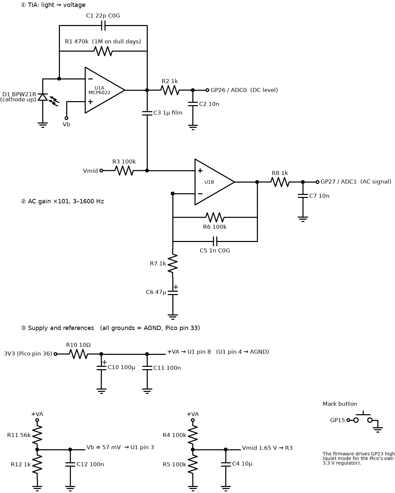

# Bench test: measure real sky and model signals

**Goal:** replace the three guesses behind the sensor design with measurements before any PCB is designed
([sensor-design.md §4](sensor-design.md#4-risks-and-unknowns)):

1. **Photocurrent range** under real skies → is one fixed amplifier gain enough?
2. **Noise floor** → the simulation assumed 2 × 10⁻⁴ per sample (7.1 × 10⁻⁵ after 1 ms smoothing)
3. **Dip from a real model** → the simulation assumed 0.5–0.6 % (15 % contrast) and ~5 ms width

It is a breadboard, a Pico 2 and a cardboard box with a slit. Total cost is about €30–35, and it can be built in an evening.

## 1. Circuit



- **① TIA:** the photodiode's current becomes a voltage: 0.47 V per µA of light current. This "DC level" goes to ADC0
  and gives the sky brightness.
- **② AC stage:** amplifies only fast changes (3–1600 Hz) 101 times, so a 0.5 % dip becomes large enough for the
  Pico's 12-bit ADC. This goes to ADC1.
- **③ Supply:** a filtered copy of the Pico's 3.3 V, plus two reference voltages: Vb ≈ 57 mV keeps the TIA output
  away from 0 V, and Vmid = 1.65 V centres the AC signal.

The Pico samples both channels 128 000 times a second each, averages them in groups of 16 and sends 8000 values a
second to the laptop. The analysis divides the AC signal by the DC level, which gives the dip **as a percentage of
the sky brightness**, the quantity the design is based on.

### Expected readings

| Sky | Photocurrent | DC level (GP26) | 0.5 % dip on AC (GP27) |
|---|---|---|---|
| Dark overcast | ~0.1 µA | ~0.1 V | ~25 mV |
| Bright overcast / blue sky | 1–2 µA | 0.5–1 V | 0.25–0.5 V |
| Bright cloud near the sun | ~4 µA | ~1.9 V | ~1 V |

On very dull days, swap R1 for 1 MΩ (and pass `--rf 1e6` to the capture script). If the capture shows **SATURATED**,
go back to 470 kΩ.

## 2. Parts list

Prices are approximate (TME, Mouser, Farnell, Reichelt or a local shop).

| Qty | Part | Ref | ≈ € |
|---|---|---|---|
| 1 | Raspberry Pi Pico 2 H (headers fitted, SC1632) | | 6 |
| 1 | Photodiode **Vishay BPW21R** (visible light only, 7.5 mm², TO-5 metal can) | D1 | 7 |
| 1 | Dual op-amp **MCP6022-I/P** (DIP-8, rail-to-rail, 3.3 V) | U1 | 2.5 |
| 1 | Resistor 10 Ω | R10 | |
| 4 | Resistor 1 kΩ | R2, R7, R8, R12 | |
| 1 | Resistor 56 kΩ | R11 | |
| 4 | Resistor 100 kΩ | R3, R4, R5, R6 | |
| 1+1 | Resistor 470 kΩ, plus 1 MΩ for dull days | R1 | 1.5 for all resistors |
| 1 | Capacitor 22 pF, C0G/NP0 ceramic | C1 | |
| 1 | Capacitor 1 nF, C0G/NP0 ceramic | C5 | |
| 2 | Capacitor 10 nF ceramic | C2, C7 | |
| 2 | Capacitor 100 nF ceramic | C11, C12 | |
| 1 | Capacitor **1 µF film** (MKS/MKT, ≥ 16 V); not ceramic | C3 | |
| 1 | Capacitor 10 µF (electrolytic or ceramic) | C4 | |
| 1 | Capacitor 47 µF electrolytic, ≥ 6.3 V | C6 | |
| 1 | Capacitor 100 µF electrolytic, ≥ 6.3 V | C10 | 3 for all capacitors |
| 1 | Tactile push button | | 0.3 |
| 1 | Breadboard (830 holes) and jumper wires | | 6 |
| 1 | Black foam board (A3, 5 mm) + matte black paint or black flock/velvet paper | | 5 |
| (1) | Blue filter gel sample (Lee/Rosco), optional | | 0–3 |
| | Micro-USB cable, laptop, camera tripod or something to stand the box on | | |

### Where to buy in Europe (checked 2026-10-20)

**One order from [TME](https://www.tme.eu) (Poland, ships across the EU) covers everything.** Reichelt (Germany) also
works for everything except the op-amp and photodiode.

| Part | Seller | Notes |
|---|---|---|
| Raspberry Pi Pico 2 **H** (headers fitted, SC1632) | [TME](https://www.tme.eu/en/details/sc1632/raspberry-pi-embedded/raspberry-pi/raspberry-pi-pico-2-h/) · [Electrokit (SE)](https://www.electrokit.com/en/raspberry-pi-pico-2-h) · [Kiwi (NL)](https://www.kiwi-electronics.com/en/raspberry-pi-pico-2-with-header-20341) · [BerryBase (DE)](https://www.berrybase.de/en/raspberry-pi-pico-2-rp2350-mikrocontroller-board-mit-headern) | |
| **Vishay BPW21R** photodiode | [TME](https://www.tme.eu/en/details/bpw21r/photodiodes/vishay/) (≈ 600 in stock) · [Farnell](https://cz.farnell.com/en-CZ/vishay/bpw21r/photodiode-565nm-to-5/dp/1045427) | ⚠ Reichelt's "BPW 21" is a **different part** (ams OSRAM). Don't confuse them |
| **MCP6022-I/P** (DIP-8) | [TME](https://www.tme.eu/en/details/mcp6022-i_p/tht-operational-amplifiers/microchip-technology/) | ⚠ Reichelt only has the MCP602 / MCP6002: slower and noisier, **don't substitute** |
| 1 µF film capacitor, 63 V, 5 mm pitch (WIMA MKS2) | [Reichelt](https://www.reichelt.com/de/en/wima-film-capacitor-rm-5-mm-1-0-f-mks2-63-1-0--p12347.html) · [TME](https://www.tme.eu/en/details/mks2-1u_63-5%25-r/tht-film-capacitors/wima/mks2c041001f00jo00/) | C3 |
| Resistors, other capacitors, button, breadboard | TME or Reichelt, any brand | Metal film 1 % resistors; C1 and C5 must be C0G/NP0 |

If the BPW21R can't be found, a BPW34 (≈ €1) works too, but it is mostly sensitive to infrared. Then put a blue gel
over the slit and note it in the recordings.

## 3. Building it

**Breadboard.** MCP6022 pins: 1 = out A, 2 = −in A, 3 = +in A, 4 = GND, 5 = +in B, 6 = −in B, 7 = out B, 8 = +VA.

| Pico 2 pin | Connects to |
|---|---|
| 36 (3V3 OUT) | R10 |
| 33 (AGND) | every ground in the schematic (one ground rail) |
| 31 (GP26 / ADC0) | R2 / C2 junction |
| 32 (GP27 / ADC1) | R8 / C7 junction |
| 20 (GP15) | push button, other side to ground |

- **Keep the TIA node small.** D1, R1 and C1 meet at U1 pin 2, which carries only microamps and picks up mains hum
  easily. Keep D1's leads short (< 10 cm, twisted together), or wrap them in foil connected to ground.
- **Cathode = the lead next to the tab** on the BPW21R's case. Check its datasheet: the cathode goes to U1 pin 2,
  the anode to ground.
- C6 and C10 are polarised: + towards R7 / R10.

**Optical box** (side view, the same geometry as the original sensor):

```
               ┌──────────────────────────┐
               │                          │  ← black inside (paint, flock or velvet)
               │                          ║ ← slit top edge: 179 mm above the detector axis  (50°)
               │                          ║
               │                          ║    slit: 10 mm wide, vertical
   D1 facing   │                          ║
   the slit,   │                          ║
   tilted up ──►[D1]                      ║ ← slit bottom edge: 24 mm above the detector axis  (9°)
   ~30°        │  · · · · · 150 mm · · · ·│
               └──────────────────────────┘   box ≈ 170 deep × 60 wide × 240 high (mm)
```

- The slit is **10 mm wide** and **150 mm** in front of the photodiode. That gives about 4° of horizontal view, like
  the original.
- Point D1 at the middle of the slit (about 30° up). Its own field of view (±50°) then covers the whole slit.
- Everything except the slit must be light-tight. Check by covering the slit: the DC level should drop to near Vb (57 mV).

## 4. Software

**Firmware:** build `firmware/bench_capture/` with the Pico SDK (`cmake .. -DPICO_BOARD=pico2 && make`). Then hold
BOOTSEL, plug the Pico in and copy `bench_capture.uf2` onto it. (It hasn't been compiled yet; see the README.)

**Laptop** (Linux or macOS):

```sh
cd sensor/sim && python3 -m venv .venv && .venv/bin/pip install -r requirements.txt
cd ../bench
../sim/.venv/bin/python capture.py --note "overcast, sensor at 21.5 m, white model"
../sim/.venv/bin/python analyze.py recordings/<file>.txt
```

`capture.py` shows a live status line: DC level, photocurrent and AC range. **Write down the conditions in `--note`
every time.** The recordings are only useful if we know what they show.

## 5. Test procedure

**A. Indoor check (15 min)**
1. Point the slit at a window. The DC level should be 0.1–2 V and the AC line steady around 1.65 V. `overruns` must stay at 0.
2. Cover the slit: the DC level falls to about 57 mV.
3. Flick a pen quickly across the slit, about 1 m away. `analyze.py` should list each flick as a pass.

**B. Sky noise (10 min per condition)**
Stand the box level, slit facing the open sky, **never towards the sun** (keep at least 10° from it; in the
northern hemisphere, facing roughly north is easiest). Nothing tall behind, and nobody walking in front of it.
Record clear blue sky, uniform overcast and broken clouds, on as many days as possible.

**C. Real models (most important)**
At a speed session, place the box exactly as the real sensor would sit: **21.5 m from the pylon, 3.8 m outside the
flight path**, slit facing the pylon, protected from the dolly. Record entire flights; nothing else is needed. Press
the mark button at engine start, to make the recording easier to find your way around. Repeat with differently coloured models and
in different light.

If no flights are possible yet: carry a model past on a pole, slowly, 3.8 m from the box, at 1 m, 2 m and 3 m
height, and press the mark button each time. `analyze.py` reports the DC dip around each mark. This measures
contrast, though not the pulse shape.

**D. Send back** the `.txt` recordings (≈ 1 MB per minute) and photos of the setup. Run them through `analyze.py` or
bring them here: the measured numbers go straight into `sensor/sim/signal_model.py`, and the design is adjusted to match.

## 6. Checking the analysis without hardware

```sh
../sim/.venv/bin/python make_test_recording.py && ../sim/.venv/bin/python analyze.py recordings/synthetic.txt
```

This generates simulated passes, runs them through a model of this circuit and analyses the result. On the last
check it found all 25 passes, measured their dip within 4 % of the true value (the 1.6 kHz filter rounds the peak
slightly) and their width within 0.2 ms.
