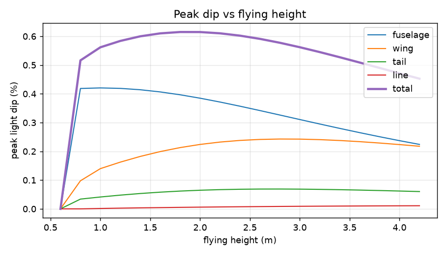
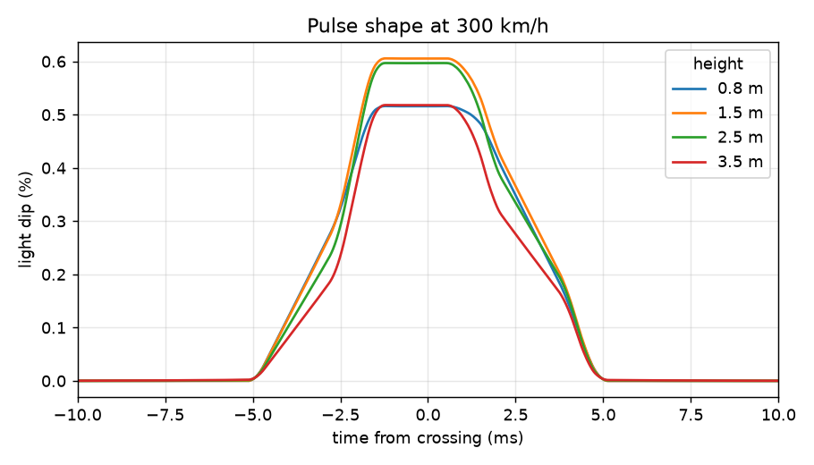
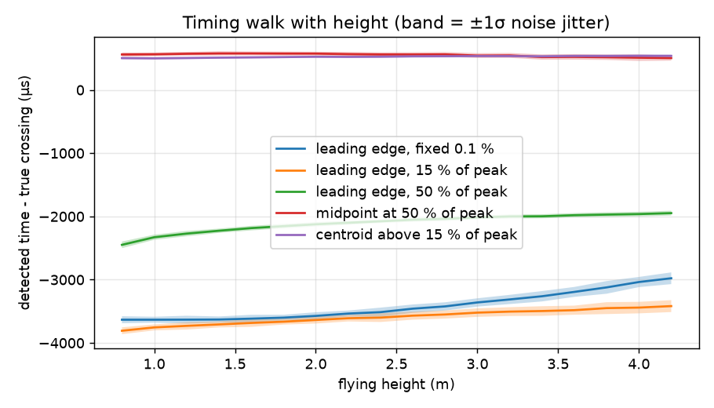

# Sensor design: a new optical pass sensor

Status: **concept, based on simulation**. Nothing here has been built or measured yet.
Model: [`sensor/sim/signal_model.py`](../sensor/sim/signal_model.py). Rerun it after changing any assumption.

## 1. What the sensor must do

| Requirement | Value | Source |
|---|---|---|
| Detect a passing F2A model | 1.0–4 m flying height, up to ~330 km/h | F2A practice |
| Timing repeatability, lap to lap | ≪ 1 ms (old system ≈ 0.4 ms vs an independent system) | original W/Ch 2004 comparison |
| Light dip to detect | ≈ 0.5 % | original design, reproduced by the model |
| Sky brightness range | ≥ 30× (dark overcast to bright cloud) | |
| Ignore | clouds, people below 9° elevation, birds and insects (shape/width), nearby R/C | |
| Placement | 21.5 m from the pylon, under the timing marker, out of the way of the dolly | as before |
| Field operation | ≥ 8 h, rain-tolerant, quick to set up and level | |

The original optics are kept: a vertical slit looking at the sky from **9° to 50° elevation, about 4° wide**,
with a blue filter and a black interior. They worked at World Championships, and the model confirms the geometry.

## 2. What the model shows



- **Signal size: 0.5–0.6 % from 1 m to 3 m**, falling to 0.45 % at 4 m. Below about 0.7 m the model is under the
  field of view and is not seen, just as with the original. The fuselage dominates at low heights and the wing at
  greater ones; the control line is negligible.
- The geometry alone gives about 4 %. Reaching the measured 0.5 % needs a **model-to-sky contrast of about 15 %**
  (models are not black, and are lit from above). **Contrast is the biggest unknown** and must be measured early.



- **The pulse is about 10 ms long (5.4 ms at half height) at 300 km/h.** Useful signal lies between roughly 50 Hz and
  1 kHz, so an 8 kHz sample rate leaves a large margin.



- **Timing on the leading edge drifts with height**, like a comparator does (the old design): 230–310 µs from
  1 m to 3 m. The field is a wedge, so a more distant (higher) model enters it earlier.
- **Timing on the centre of the pulse removes that drift.** The pulse centroid drifts **36 µs** over 1–3 m, with
  **18 µs** jitter. That is about **8× better** than a leading-edge comparator, and only possible because the new
  sensor digitizes the whole pulse. The constant offset (≈ +0.5 ms) cancels in every lap time.
- **Levelling is now the largest error.** A sideways tilt of 1° shifts timing by **420 µs** between a 1 m and a 3 m
  pass (3°: 1.3 ms), because the slit plane is no longer vertical. ⇒ The sensor gets a built-in tilt sensor, and
  the app shows a level indicator with a target of **< 0.1° (≈ 40 µs)**.

Simulation conditions: 300 km/h, 15 % contrast, 0.02 % rms noise per sample at 8 kHz, and the sky brightening
by 5 %/s (a passing cloud edge). Detection only accepts dips shorter than 25 ms, which rejects cloud changes.

## 3. Proposed architecture

The sensor digitizes the light level and runs the detection itself. It sends **timestamps**, not pulses, so the
cable length and the PC never affect the timing.

```
 ┌─────────────────────────── sensor head ────────────────────────────┐
 │ slit + blue filter                                                  │
 │      │                                                              │
 │ photodiode ─► TIA (1 MΩ) ─► 24-bit ΔΣ ADC ─► RP2350 (Pico 2)         │
 │                              8 kSps, clock      sky baseline, pulse  │
 │                              from the MCU       detection, centroid  │
 │                                                 timestamp, waveforms │
 │ 3-axis accelerometer (tilt) ───────────────────────┤                │
 │                                                    ▼                │
 │ 12 V in ─► regulator                        RS-485 transceiver       │
 └──────────────────────────────────────────────────┬──────────────────┘
                              76 m Cat5e: 1 pair data, 2 pairs 12 V/GND
 ┌──────────── base station ────────────────────────┴──────────────────┐
 │ RS-485 ◄─► Pico ◄── handle switch          USB ──► Linux PC (Python) │
 └──────────────────────────────────────────────────────────────────────┘
```

| Block | Choice | Why |
|---|---|---|
| Detector | Silicon photodiode, visible range (no IR peak), ~1–7 mm² | Linear and quiet, unlike the phototransistor; IR rejection matches the blue filter's purpose |
| Front end | Transimpedance amplifier, low-bias CMOS op-amp, Rf ≈ 1 MΩ | One fixed gain covers the whole sky range (see the budget below); no log amplifier needed |
| ADC | 24-bit delta-sigma, 2 channels, ~8 kSps (ADS131M02 class) | Resolves 0.5 % of a dim sky with margin; the 2nd channel is spare (see §5) |
| Processing | RP2350 (Raspberry Pi Pico 2) | Has an FPU, and the same toolchain and code base as the base station |
| Timing | Sample index × ADC clock, derived from the MCU crystal | The timestamp follows from the sample count: no interrupt latency at all |
| Tilt | MEMS accelerometer | Live level indicator; logs the tilt with every flight |
| Link | RS-485, 76 m Cat5e, power over spare pairs | Robust, cheap, no battery to manage at the sensor; wireless can come later |
| Base station | Pico + RS-485 + handle switch, USB to the PC | The PC protocol stays as already implemented (`docs/protocol.md`) |

### Signal budget (estimates, to be measured)

| | Dark overcast | Bright sky / cloud |
|---|---|---|
| Sky luminance | ~300 cd/m² | ~10 000 cd/m² |
| Illuminance at the detector (0.043 sr field) | ~13 lx | ~430 lx |
| Photocurrent (≈ 5 nA/lx after the filter) | ~65 nA | ~2 µA |
| TIA output (1 MΩ) | 65 mV | 2.0 V |
| 0.5 % dip | 330 µV | 10 mV |
| Noise (shot + resistor), 4 kHz bandwidth | ≈ 1.3 × 10⁻⁴ relative | ≈ 3 × 10⁻⁵ relative |

Even the dark case is better than the 2 × 10⁻⁴ the simulation assumed, though without much margin (the 1 MΩ resistor's own noise dominates); a single gain range should work.
The first measurement will confirm or correct this.

## 4. Risks and unknowns

1. **Model contrast against the sky.** It sets the signal size; measure it with real models, light and dark,
   in sun and overcast.
2. **Real sky noise** (scintillation, haze, flicker from nearby objects), which the model doesn't include.
3. **Direct sun**: as before, keep at least 10° between the sun and the field of view. The app can calculate
   this from the date, time and the sensor's compass direction.
4. **Model dimensions** in the simulation are typical guesses; they are easy to update.

## 5. Options to evaluate next

- **Two slits side by side**, one per ADC channel. A model crosses them a few ms apart while a cloud changes both
  at once. Subtracting them cancels sky changes, the order of the two crossings gives the direction, and having two
  timings adds redundancy. This is cheap to add, since the ADC already has 2 channels.
- **Wireless link and battery** (LoRa or 2.4 GHz) instead of the cable. Timing is unaffected because the sensor
  timestamps itself.
- **Other categories** (F2C team race, F2B?) only need different models and detection parameters.

## 6. Next steps

1. **Breadboard measurement** (inexpensive): a photodiode, an op-amp TIA and a Pico 2 aimed at the sky, logging raw
   samples. Fly or swing a model through the field: this measures contrast, sky noise and the photocurrent range.
2. KiCad schematic and PCB for the sensor head and base station.
3. Parametric enclosure (3D-printable) with the slit geometry, filter holder, tripod mount and bubble level.
4. Port the detector from `signal_model.py` to the sensor firmware.
